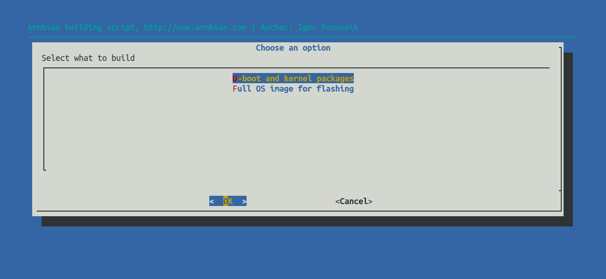

<h2 align="center">
  <a href=#></a>
  <br><br>
</h2>

# Armbian Linux Build Framework

## Purpose of This Repository

The **Armbian Linux build framework** builds customizable OS images based on **Debian** or **Ubuntu** for single-board computers (SBCs) and embedded devices. It assembles the kernel, bootloader, root filesystem, firmware, device trees, and board-specific tuning for a wide range of ARM, RISC-V, and x86 targets.

The framework supports **native**, **cross**, and **containerized** builds and is used both interactively and from CI.

> **Looking for prebuilt images?** Use [Armbian Imager](https://github.com/armbian/imager/releases) — the easiest way to download and flash Armbian to an SD card or USB drive. Available for Linux, macOS, and Windows.

## Quick Start

```bash
git clone https://github.com/armbian/build
cd build
./compile.sh
```

<a href="#quick-start"></a>

Run with no arguments to get the interactive menu, or pass build variables on the command line (e.g. `BOARD=`, `BRANCH=`, `RELEASE=`, `BUILD_MINIMAL=`, `BUILD_DESKTOP=`). The entrypoint is `compile.sh`; the framework code lives under `lib/`.

## Build Host Requirements

### Hardware
- **RAM:** ≥ 8 GB (less is possible with `KERNEL_BTF=no`)
- **Disk:** ~50 GB free
- **Host architecture:** `x86_64`, `aarch64`, or `riscv64`

### Operating system
- **Native builds:** Armbian / Debian 13 (Trixie)
- **Containerized:** any Docker-capable Linux
- **Windows:** WSL2 with Armbian / Debian 13 (Trixie)

### Tooling
- Superuser privileges (`sudo` or root)
- An up-to-date host — outdated Docker or distro tooling is a frequent cause of build failures

Host dependencies are installed automatically; you can also prepare them explicitly with:

```bash
sudo ./compile.sh requirements
```

## What's Built With

- **Bash** — the build engine itself (`compile.sh`, everything under `lib/`, `extensions/`, and most of `packages/`)
- **GNU Make / Kbuild** — kernel `Makefile`s and the device-tree overlay `Makefile`s shipped under `patch/kernel/archive/*/overlay/`
- **Patches** — thousands of kernel and u-boot patches under `patch/`
- **Shell configuration fragments** — per-board, per-family, per-release config files under `config/`
- **YAML** — GitHub Actions workflows, labeler config, dependabot config, issue templates
- **JavaScript** — small GitHub Actions helper scripts under `.github/scripts/`
- **Device Tree Source** — overlays and board DTs under `patch/kernel/` and `config/`

## Repository Layout

| Path | Purpose |
|:--|:--|
| `compile.sh` | Main entrypoint; parses CLI/menu input and hands off to `lib/` |
| `action.yml` | Composite GitHub Action ("Rebuild Armbian") that drives builds from CI |
| `lib/` | The build engine — functions, tool wrappers, and the CLI machinery |
| `config/boards/` | One file per supported board (see extensions table below) |
| `config/bootenv/` | Board/family boot environment fragments |
| `config/cli/` | Package sets for CLI (minimal / server) images |
| `config/distributions/` | Supported Debian/Ubuntu release definitions |
| `config/its/` | Image Tree Source files for the device-tree image builder |
| `extensions/` | Opt-in build extensions enabled via `ENABLE_EXTENSIONS=` |
| `packages/` | Deb packaging sources — `armbian` (kernel packaging), `bsp`, `bsp-cli`, `bsp-desktop`, `blobs`, `extras-buildpkgs` |
| `patch/kernel/` | Per-kernel-branch patch sets and device-tree overlays |
| `patch/u-boot/` | Per-u-boot-branch patch sets, including migration dirs (e.g. `v2026.07-sunxi`, `v2026.07-sunxi64`) |
| `tools/` | Helper utilities (see `tools/README.md`) |
| `.github/` | Workflows, issue/PR templates, CODEOWNERS generator, labels |

### Board configuration file extensions

Each board under `config/boards/` carries its support status in its file extension (see `config/boards/README.md` for the full option reference, and `config/distributions/README.md` for the parallel release-status scheme):

| Extension | Meaning |
|:--|:--|
| `.conf` | Supported — current package base |
| `.csc` | Community supported / unstable — no active Armbian maintainer |
| `.wip` | Work in progress |
| `.eos` | End of life (former release) |
| `.tvb` | TV box, community supported (no Armbian maintainer) |

## Using It as a GitHub Action

This repository also exposes a reusable composite action (`action.yml`) called **"Rebuild Armbian"**, which checks out `armbian/os` and this repo and runs the build. Selected inputs with their defaults:

| Input | Default |
|:--|:--|
| `armbian_target` | `kernel` |
| `armbian_board` | `uefi-x86` |
| `armbian_branch` | `main` |
| `armbian_kernel_branch` | `current` |
| `armbian_release` | `noble` |
| `armbian_ui` | `minimal` |
| `armbian_compress` | `sha,img,xz` |
| `armbian_artifacts` | `build/output/images/` |

See `action.yml` for the full list, including GPG-signing, release-publishing, and asset-manifest options.

## Continuous Integration

CI runs this repository on both GitHub-hosted and self-hosted runners (see `.github/workflows/README.md` for runner tagging and setup).

For a live overview of this repository's workflows and runs, see the Armbian CI dashboard:

👉 <https://actions.armbian.com/?repo=build>

## Resources

- **[Documentation](https://docs.armbian.com/Developer-Guide_Overview/)** — guides for building, configuring, and customizing
- **[Website](https://www.armbian.com)** — news, features, and supported boards
- **[Blog](https://blog.armbian.com)** — development updates and technical articles
- **[Forums](https://forum.armbian.com)** — community support and discussion

## Contributing

Contributions are welcome. See [CONTRIBUTING.md](CONTRIBUTING.md) for how to report issues, prepare patches, and submit pull requests, and [AGENTS.md](AGENTS.md) for the project's guidelines on generated prose (commit messages, PR text, patch cover letters).

Credits are listed in [CREDITS.md](CREDITS.md).

## Support

### Community Forums
Help from users and contributors on troubleshooting, configuration, and development.
👉 [forum.armbian.com](https://forum.armbian.com)

### Real-time Chat
IRC and Discord channels for developers and community members.
👉 [Community Chat](https://docs.armbian.com/Community_IRC/)

### Paid Consultation
For commercial projects, guaranteed response times, or advanced needs, paid support is available from Armbian maintainers.
👉 [Contact us](https://www.armbian.com/contact)

## License

This project is released under the **GNU General Public License v2** — see [LICENSE](LICENSE).

## Contributors

Thank you to everyone who has contributed to Armbian.

<a href="https://github.com/armbian/build/graphs/contributors">
  
</a>

## Armbian Partners

Our [partnership program](https://forum.armbian.com/subscriptions) supports Armbian's development and community. Learn more about [our Partners](https://armbian.com/partners).
